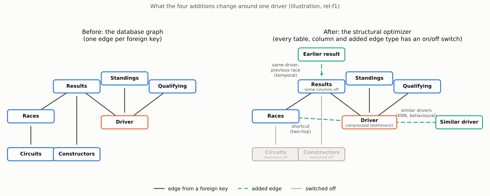
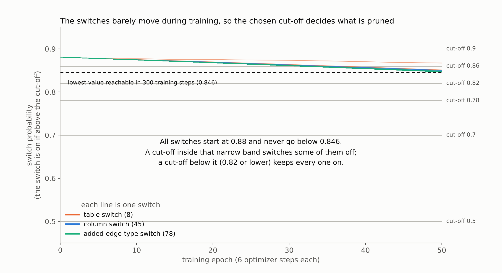
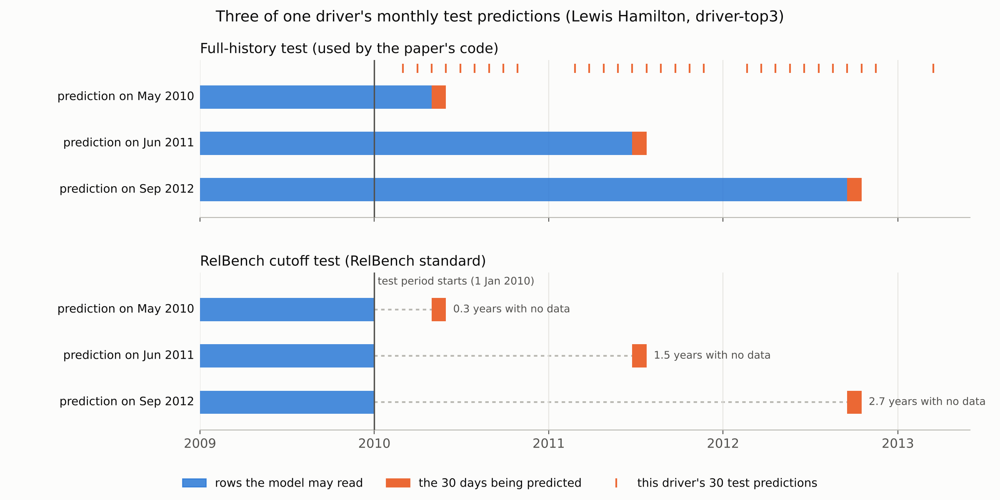

# Learning the Graph for Relational Deep Learning, in PyG

<!-- Draft of the CS224W blog post (Medium). TODO marks open items. -->

*Harshal Kulkarni, CS224W project. Code:
[PyG `contrib` PR](https://github.com/HARSHALK2598/pytorch_geometric/tree/contrib/structural-optimizer),
[experiments](https://github.com/HARSHALK2598/cs224w-structural-optimizer).*

## Names used in this post

| Name | Meaning |
|---|---|
| **GraphSAGE baseline** | RelBench's standard GNN model, with nothing learned about the graph |
| **Structural optimizer** | the paper's method: the baseline plus four additions (Section 2) |
| **Paper's code**, **released model** | the authors' GitHub code, and the trained model they published |
| **Full-history test** | the paper's test setup: a prediction at time *t* may use every row before *t* |
| **RelBench cutoff test** | RelBench's standard setup: test predictions use only rows before the test period |

**Main assumption.** All numbers use the full-history test unless marked, because that is
how the paper's code evaluates. Section 5 explains why this matters.

## 1. Motivation

Relational deep learning (lectures 13–16) trains GNNs directly on databases. Every row
becomes a node and every foreign-key link becomes an edge. In rel-f1, for example, a
driver connects to their race results, standings and qualifying rows, and each result
connects to its race and constructor.

This graph comes from the schema, not from the task. The paper (Cheng & Luo, ICML 2026)
names two problems with it:
- **Information overload.** Many tables and columns are irrelevant to a given prediction,
  yet message passing averages them in.
- **Semantic fragmentation.** Rows that should inform each other can be many hops apart, or
  not linked at all. Two drivers with similar form, for example, share no edge.

Its answer is to learn the graph for each task, end to end, without changing the GNN.
Nothing in PyG does this at training time. PyG's explainers learn feature and edge masks
only after training, for one prediction at a time.

## 2. The structural optimizer

The GraphSAGE baseline has three steps: encode each row's columns into a vector, run
message passing over the database graph, and predict with an MLP. The structural
optimizer keeps all three and inserts four additions.

1. **Table and channel switches**, between the encoder and the GNN. Each table *T* gets one
   switch *s_T*, and each channel of its embedding gets a switch *g_T*. A row's vector
   becomes *s_T · (g_T ⊙ h)*. The paper calls these column-level switches; its code, and our
   default, put them on embedding channels (Section 7).
2. **Added edges**, built for each batch from four templates:
   - *temporal*: each record links to the same entity's previous *m* records;
   - *two-hop shortcut*: A → B → C becomes a direct A → C edge;
   - *KNN*: each driver links to its *n* most similar drivers;
   - *behavioural*: drivers link when their linked rows look alike.
3. **Edge-type switches.** One switch per added edge type decides whether the GNN uses it.
4. **Bottleneck.** Before message passing, each node's vector is compressed with a
   variational information bottleneck, which removes detail the task does not need.

**How the switches work.** Each switch is a Hard-Concrete gate (Louizos et al.): a learned
logit, sampled during training so it stays differentiable. The loss adds a penalty on the
expected number of open switches, plus the bottleneck's KL term:

*loss = task loss + λ · (expected open switches) + β · KL*

At test time a switch is open if *sigmoid(logit) > threshold*. The paper's code tries six
thresholds from 0.5 to 0.9 and keeps the one that scores best on validation.


*Figure 1. Around one driver in rel-f1, before and after the four additions (illustration;
which tables and columns switch off is learned per task).*

Course connections:
- two-hop shortcuts are close to RelGNN's atomic routes;
- the rule that a prediction sees only earlier rows is RT's sampling rule;
- edge-type switches play the role of R-GCN's per-relation weights and InGram's relation
  importance.

## 3. Implementation in PyG

Each addition is its own module in `torch_geometric.contrib`, so it can be used alone:

| Class | Addition |
|---|---|
| `HardConcreteGate` | the switches (1, 3) |
| `RelationalFilter` | table and column switches (1) |
| `KNNEdges`, `BehavioralEdges`, `TwoHopEdges`, `TemporalContinuity` | added edges (2) |
| `GatedHeteroConv` | message passing with edge-type switches (3) |
| `VariationalBottleneck` | bottleneck (4) |
| `StructuralOptimizer` | all four, each behind a flag |

Usage on RelBench (from `examples/contrib/structural_optimizer_relbench.py`):

```python
from torch_geometric.contrib.nn.models import (KNNEdges, StructuralOptimizer,
                                               TwoHopEdges)
from torch_geometric.contrib.transforms import TemporalContinuity
from torch_geometric.contrib.utils import from_relbench

# The database graph, plus temporal edges (prefixed 'next__'):
data = TemporalContinuity()(from_relbench(dataset.get_db()))
schema = [et for et in data.edge_types if not et[1].startswith('next__')]
temporal = [et for et in data.edge_types if et[1].startswith('next__')]

model = StructuralOptimizer(
    data.node_types, schema, channels=64, out_channels=1,
    gated_tables=[nt for nt in data.node_types if nt != 'drivers'],
    templates=[KNNEdges('drivers', k=5), *TwoHopEdges.instances(schema)],
    injected_edge_types=temporal, template_gates=True, vib=True,
    lambda_table=1e-3, lambda_template=1e-3, beta_vib=1e-3)

# In the training loop, on a NeighborLoader batch:
pred = model(x_dict, batch.edge_index_dict, 'drivers', batch.batch_dict,
             batch['drivers'].seed_time, num_targets)
loss = task_loss(pred, y) + model.structural_loss()
```

Design choices:
- **Added edges respect time.** They are built per batch, inside each prediction's own
  sampled subgraph, so they only connect rows from before that prediction's date.
- **Closed means skipped.** A switched-off edge type is not computed at all, so pruning
  saves compute.
- **Off means baseline.** With every flag off, `StructuralOptimizer` is exactly the
  GraphSAGE baseline, and a test checks this.

Tests: `test/contrib` 89 passed, 11 skipped; experiment tests 60 passed.
TODO: CUDA, and GAT/GraphConv as the convolution.

## 4. Results on rel-f1 driver-top3, and why

The task: will a driver finish in the top 3 in the next month? Test ROC-AUC, mean ± std
over 3 seeds unless marked. These rel-f1 runs predate the fixes of Section 7 (they used
per-column switches, a fixed switch temperature and cross-subgraph KNN edges). We trained
with three sets of settings:
- **repo settings**: the paper's code's defaults, 2 GNN layers;
- **checkpoint settings**: the settings saved inside the released model, 1 layer, learning
  rate 3e-3;
- **tuned settings**: chosen by us on validation, 1 layer and switch penalty 1e-4.

| Model | Repo settings | Checkpoint settings | Tuned settings | Paper |
|---|---|---|---|---|
| GraphSAGE baseline, our implementation | 82.48 ± 5.75 | 90.22 ± 0.32 | **87.86 ± 0.83** | 81.48 ± 1.06 |
| Structural optimizer, our implementation | 88.06 ± 0.83 | 89.90 ± 0.99 | **88.48 ± 1.05** | 86.82 |
| Structural optimizer, paper's code (1 seed) | 84.52 | – | – | |
| Released model | – | 90.33 | – | |

Our implementation reproduces the released model, 89.90 vs 90.33, and beats the paper's
86.82. Once both models are tuned, though, the structural optimizer is only 0.6 points
above the baseline, within one standard deviation. Three mechanisms explain why.

**One GNN layer carries the signal.** Whether a driver finishes top 3 depends mainly on
their own recent results, standings and qualifying rows, all one hop away. A second layer
adds races, circuits and constructors. That brings little signal and many more nodes, and
with 1,353 training rows the model overfits. The baseline goes from 82.48 ± 5.75 with 2
layers to 87.86 ± 0.83 with 1.

**The switches can barely move.**
- A run is only 300 optimizer steps (6 per epoch, 50 epochs), and Adam moves a weight by at
  most about the learning rate per step.
- A switch starts at probability 0.88 (logit 2). At learning rate 1e-3 it can't go below
  0.846; to close at threshold 0.5 it would need about 2,000 steps. Every switch in our
  tuned runs ended between 0.848 and 0.878.
- So pruning comes only from the threshold search. A threshold like 0.86 falls in the small
  gap the penalty opened and closes the switches below it.
- The released model, at 0.86, keeps only the results, standings and qualifying tables:
  the same one-hop signal. Our runs with checkpoint settings did this for one seed, and kept
  almost everything for the other two, with equal scores.


*Figure 3. Every switch over one training run with the tuned settings (seed 0). The grey
lines are the six test-time cut-offs the threshold search tries.*

**Only driver-to-driver edges are active.**
- With one layer, only edges that point into the driver can change its prediction.
  - Temporal edges link results to results, and their information would need a second
    layer to reach the driver.
  - Two-hop shortcuts need paths of length two, which a one-layer subgraph doesn't have.
- We counted all 64,480 added edges in the test batches: every one was a KNN or
  behavioural driver-to-driver edge.
- These edges bring in other drivers' columns, such as nationality, which say little about
  next month's result. So with every switch open, the structural optimizer is essentially
  the baseline. With the paper's same-subgraph rule (Section 7), these edges disappear
  entirely on rel-f1, since each prediction's subgraph holds only one driver.

The last 2 points between our tuned baseline (87.86) and the checkpoint settings (90.22)
come from settings we did not tune: learning rate, hidden size, neighbour count and
penalties. Several checkpoint values fall outside the paper's own search ranges (Table 8).

## 5. The test setup is the main assumption

- Test predictions are monthly, from 2010-03 to 2013-03: the same 42 drivers, about 17
  times each.
- Under the full-history test, a 2012 prediction sees every race before 2012, including
  the races that decided that driver's earlier test labels. Under the RelBench cutoff test,
  it sees only rows before 2010.
- No prediction sees its own answer. We checked that no sampled row and no added edge comes
  from after a prediction's own date.
- But recent form is exactly the signal that matters (Section 4). The full-history test is
  therefore an easier task, and its scores are not comparable with RelBench numbers.

| Test ROC-AUC | Full-history test | RelBench cutoff test |
|---|---|---|
| Released model | 90.33 | 83.98 |
| Structural optimizer, paper's code, repo settings (1 seed) | 84.52 | 78.35 |
| Structural optimizer, our implementation, repo settings | 88.06 ± 0.83 | 75.11 ± 2.62 |
| GraphSAGE baseline, our implementation, repo settings | 82.48 ± 5.75 | 78.42 ± 0.89 |

Under the cutoff, the structural optimizer falls below the baseline. A plausible reason is
that its extra parameters fit recent-form signals that are up to three years stale under
the cutoff. We did not test this.


*Figure 2. Three of one driver's 30 monthly test predictions, and the rows each may read
under the two test setups.*

## 6. A second task: rel-f1 driver-dnf

The task: will a driver fail to finish (DNF) a race in the next month? We used the tuned
settings from driver-top3 unchanged, with the full-history test and 3 seeds.

| Test ROC-AUC | Seed 0 | Seed 1 | Seed 2 | Mean ± std |
|---|---|---|---|---|
| GraphSAGE baseline | 78.93 | 79.45 | 79.44 | **79.27 ± 0.30** |
| Structural optimizer | 79.45 | 79.46 | 79.47 | **79.46 ± 0.01** |
| Paper, structural optimizer | | | | 78.21 |
| Released model (checkpoint settings) | | | | 80.41 |

- Both models beat the paper's number, and are level with each other.
- No switch closed: with 2,250 training steps the switches moved further (to 0.59–0.83) but
  validation chose the 0.5 cut-off every time. The released model also keeps everything.
- The gap to the released model is not like-for-like: it used its own checkpoint settings.
- Under the RelBench cutoff test, the released model drops from 80.41 to 72.02.

## 7. rel-trial study-outcome: a failure, and what fixed it

The task: will a clinical trial succeed? Paper: baseline 69.44 ± 0.53, structural optimizer
72.35. No released model exists. The run needs 14+ GB of memory, so it ran on Kaggle CPUs.

**The first result was a clear failure.** With the settings from driver-top3, the
structural optimizer scored 59.13 ± 2.30 on test against the baseline's 66.57 ± 1.39, and
its training loss stayed near 0.65 for all 50 epochs: it learned almost nothing. A second
layer did not help (57.13); for the baseline it did (68.59), since a trial's conditions,
drugs and sponsors sit two hops away, behind link tables.

**Ablations found no single broken part.** Turning on one addition at a time (10 epochs),
each of the bottleneck, the switches and the added edges slowed training on its own
(training loss 0.639–0.644 against the baseline's 0.630). What they share is noise during
training, which a strong signal (rel-f1) survives and a weak one (rel-trial) does not.

**Comparing with the paper's code found five differences**, none fixed by the paper's text:

| | Paper's code | Our first version | Now |
|---|---|---|---|
| Bottleneck noise at the start | spread 0.37 for every row | spread ≈ 1.0, row-dependent | **as theirs** |
| Switch temperature | 2.0, lowered during training | fixed at 2/3 | **schedule as theirs** (option) |
| KNN and behavioural edges | within a prediction's own subgraph | also across subgraphs (never later ones) | **as theirs** (default) |
| Feature statistics (full-history test) | rows before the first training date | all rows | **as theirs** (default) |
| Column switches | per embedding channel | per database column | **per channel** (default) |
| Two-hop round trips A → B → A | included | excluded | excluded: through one foreign key they mostly return to the same row |

The bottleneck still hurt after its fix, even at weight 1e-4: its KL penalty is summed over
128 channels and 15 tables and outweighed the task loss. We turned it off for this task, as
the authors did for 5 of their 9 released models.

**Final round** (2 layers, 50 epochs, seed 0, the paper's penalties: column/table 1e-3,
edge types 1e-2):

| study-outcome | Validation | Test |
|---|---|---|
| GraphSAGE baseline | 65.87 | **68.29** |
| Structural optimizer, per-channel switches | 66.65 | **68.15** |
| Structural optimizer, per-column switches | 63.27 | 65.85 |
| Paper: baseline / structural optimizer | – | 69.44 / 72.35 |

- After the fixes, the structural optimizer trains normally and is level with the baseline.
- Per-channel switches act like a learned dropout on the embedding; per-column switches
  rescale the encoder's inputs every batch and train worse. Per-channel is now our default,
  at the cost of no longer saying which database columns matter.
- Nothing was pruned: every switch stayed on at the 0.5 cut-off, though the penalties were
  still falling at epoch 50.
- We remain about 1 point below the paper's baseline and 4 below its structural optimizer,
  with one seed and settings not tuned for this task.

**Other databases.** TODO: the tasks with released models (rel-event, rel-hm, rel-stack,
rel-amazon), with the fixed implementation and each model's own settings. The last three
need a GPU.

## 8. Takeaways

1. Our PyG implementation reproduces the released model on driver-top3, given the same
   settings and test setup, and beats the paper's number on driver-dnf.
2. Details the paper leaves open matter: on rel-trial, five differences from the authors'
   code (noise scale, temperature schedule, edge scope, feature statistics, switch
   granularity) decided whether the method learned at all.
3. On all three tasks, the full structural optimizer is level with a tuned GraphSAGE
   baseline. Most of the gains we see come from settings (the number of layers) and from
   the full-history test.
4. The switches rarely prune: they move slowly, and pruning comes from a cut-off search over
   nearly equal values, which changes from seed to seed.

## References

- Cheng & Luo, *What Makes a Desired Graph for Relational Deep Learning?*, ICML 2026.
- Fey et al., Relational Deep Learning; Robinson et al., RelBench; Louizos et al., L0
  regularisation (Hard-Concrete); Alemi et al., Deep Variational Information Bottleneck.
- TODO: RelGNN, RT, R-GCN, InGram.
